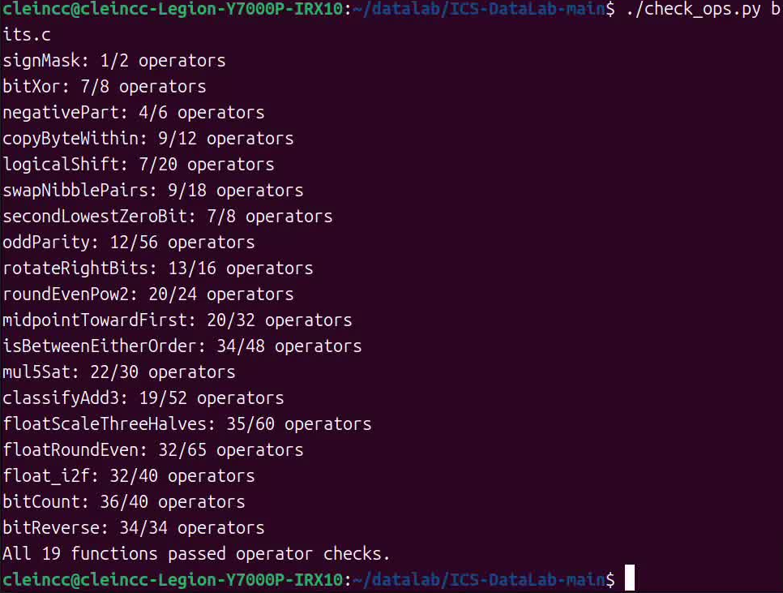
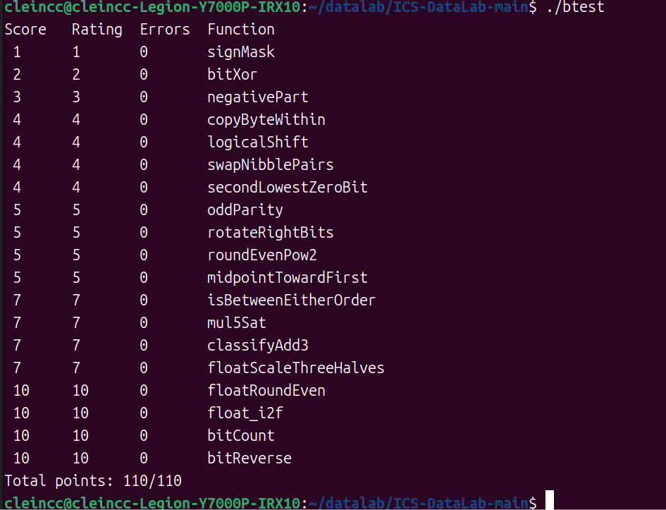

# Lab1 DataLab 实验报告

姓名：李天呈　学号：25803050053

## 实验内容

在指定编码限制下，实现 `bits.c` 中的 19 个函数，处理整数和浮点数的运算与舍入。

## 函数实现思路

### P1 `signMask`

将 `1` 左移 31 位，得到只有最高位为 1 的掩码。

### P2 `bitXor`

异或要求对应位不相同。`~(~x&~y)` 排除两个位都为 0 的情况，`~(x&y)` 排除两个位都为 1 的情况，按位与后得到不同的位。

### P3 `negativePart`

`~x+1` 是补码取负。`x>>31` 在负数时为全 1，在非负数时为全 0，将它与取负结果按位与，就能选择需要的返回值。

### P4 `copyByteWithin`

先将字节下标乘以 8，得到位移量。源字节右移后与 `255`，提取出低 8 位；目标字节用 `~(255<<r)` 清空。最后将源字节移到目标位置并按位或，其他字节不变。

### P5 `logicalShift`

将所有位向右移动，丢弃移出右端的位，并在左侧补 0。

先构造低 `32-n` 位为 1 的掩码：从低 31 位为 1 的 `0x7fffffff` 开始右移 `n` 位后剩下 `31-n` 个 1，再左移一位补上最低位的 1。

将右移结果与掩码按位与即可。

### P6 `swapNibblePairs`

先用小常量构造 `0x0f0f0f0f`。每个字节的低四位提取后左移四位，高四位右移后再提取，最后合并。

### P7 `secondLowestZeroBit`

先令 `y=~x`，把查找 0 位转成查找 1 位。`y&(y-1)` 干掉最低的一个 1，随后 `y&(-y)` 提取剩余的最低 1，它对应原数的第二个低位 0。用 `y+~0` 和 `~y+1` 构造减一、取负。原数不足两个 0 位时返回 0。

### P8 `oddParity`

依次将右移 16、8、4、2、1 位的结果与原数异或，把全部位的异或值归并到最低位。最终最低位为 1 表示原数有奇数个 1，所以最后再用 `!(x&1)` 取反。

### P9 `rotateRightBits`

先用 `n&31` 将位移量限制在 0～31。右侧部分使用与 P5 相同的做法得到 logicalshift 结果，绕回高位的部分通过左移得到，两者按位或。

### P10 `roundEvenPow2`

先求出除以 `2^n` 的商 `q=x>>n` 和余数 `r=x&((1<<n)-1)`，再令中值 `h=2^(n-1)`。余数小于中值时保持商不变，大于半程时将商加 1；等于中值时，只有商为奇数才加 1。最后将舍入后的商左移 `n` 位，恢复为 `2^n` 的倍数。

不能使用比较运算符，所以用 `h-r` 的符号判断 `r>h`，用 `!(r^h)` 判断相等；减法也写成补码加法。

### P11 `midpointTowardFirst`

先分别将两数除以二：`a=x>>1`、`b=y>>1`；同时保存余数 `rx=x&1`、`ry=y&1`。算术右移相当于向下取整，因此满足 `x=2a+rx`、`y=2b+ry`。

向下取整的中点为 `a+b+(rx&ry)`，避免直接计算 `x+y`。比较原数时先比较 `a` 和 `b`，二者相同再比较余数。`b-a` 还是用差值的符号判断大小。

当且仅当两个余数不同、且 `x>y` 时，将中点加 1，使其向第一个参数靠拢。

### P12 `isBetweenEitherOrder`

直接按 `(x>=a 且 x<=b) 或 (x>=b 且 x<=a)` 判断。先分别求出 `x<a`、`x<b` 和两个相等条件，再组合出四个包含等号的比较结果。

比较时区分是否异号：异号时负数较小，同号时再看差值符号，避免跨符号相减溢出而误判。

### P13 `mul5Sat`

通过加法依次得到 `2x`、`4x` 和 `5x`。同号相加发生溢出时，结果会变号，因此检查 `x` 与 `2x`、`2x` 与 `4x`、`x` 与最终结果之间的符号变化，合并成溢出掩码。

分别用 `o1`、`o2`、`o3` 保存这三处符号变化，再合并。未溢出时返回 `5x` 的低 32 位，溢出时按原数符号选择 `INT_MAX` 或 `INT_MIN`。

### P14 `classifyAdd3`

依次计算 `s=x+y` 和 `t=s+z`，分别检查两次有符号加法是否溢出。同号相加而结果变号才发生溢出：`~(x^y)` 筛选同号位，`x^s` 检查结果是否变号，二者按位与后取符号位，得到第一次的溢出掩码；第二次同理。

每次正溢出记为 `1`、负溢出记为 `-1`、未溢出记为 `0`，存入 `d1`、`d2`。代码中 `(x>>31)|1` 在非负数时为 `1`、负数时为 `-1`，与溢出掩码按位与即可得到该次记录。

两次记录相加就是最终溢出情况，处理中间溢出被抵消的情况。

### P15 `floatScaleThreeHalves`

拆出符号、阶码和尾数。规格化数补回隐藏的最高位 1，再直接计算有效数字的三倍。

然后按情况处理：非规格化数没有隐藏位，三倍有效数字右移一位；规格化数若三倍有效数字达到 `2^25`，右移两位并将阶码加 1，否则右移一位。

右移一位时，被丢弃的 1 位为半程，只有保留部分为奇数才进位。右移两位时，余数大于 2 则进位，等于 2 且保留部分为奇数也进位。先精确乘三、最后只舍入一次，避免两次舍入影响结果。

输入 NaN、无穷大原样返回，正负零保留符号。

### P16 `floatRoundEven`

按阶码分类处理。绝对值小于 `0.5` 时返回带原符号的零；在 `[0.5,1)` 内，恰好 `0.5` 取偶舍入为零，其余舍入到带符号的 1。

中间范围令 `k=150-e`，补回隐藏位，清除有效数字中表示小数的低 `k` 位，再根据余数和半程决定是否加上 `1<<k`。中点处检查保留部分的最低位，保证取偶。若进位使有效数字超出 24 位，就右移一位、将阶码加 1，最后重新拼接三个字段。

阶码达到 150 的有限数已经没有小数部分，可以直接返回；NaN、无穷大也原样返回。

### P17 `float_i2f`

先保存符号，在 `unsigned` 中求绝对值，避免对 `INT_MIN` 进行有符号取负。找到最高 1 的位置 `k`，阶码为 `k+127`。

有效数字不超过 24 位时，左移对齐即可精确表示；超过 24 位时右移，按丢弃部分与半程的关系进行取偶舍入。如果舍入使有效数字多出一位，就再右移一位并增加阶码。最后去掉隐藏位，拼接符号、阶码和尾数；输入零单独返回零。

### P18 `bitCount`

将 32 位整数看成四个字节，分别统计每个字节中 1 的数量，最后把四个计数相加。

先用小常量构造 `m=0x01010101`，其每个字节都只有最低位为 1。`(x>>k)&m` 同时提取四个字节中的第 `k` 位，每个字节的结果都是 0 或 1。将 `k=0` 到 `7` 的八项相加后，`s` 的四个字节就分别保存四个计数。每个计数最多仅为 8，因此不会在字节之间进位。

### P19 `bitReverse`

依次交换高低 16 位、每个 16 位分组内的两个 8 位、每 8 位的两个 4 位、每 4 位的两个 2 位，最后交换相邻位组，完成全部 32 位的反转。

先构造 `m=0x0000ffff`，随后复用 `m^(m<<k)`，依次生成 `0x00ff00ff`、`0x0f0f0f0f`、`0x33333333`、`0x55555555`。

## 本地测试结果

结果显示 `All 19 functions passed operator checks.`。

